## Contenido {style="font-size: 90%;"}

1. Introducción
2. Análisis de sentimientos
3. Clasificación de texto
4. Bolsa de palabras
5. Más allá de la bolsa de palabras
6. Un modelo de lenguaje como clasificador
7. Conclusiones

# Introducción

## Definiciones

:::: {.columns}
::: {.callout-note icon="false" .column}
### Inteligencia Artificial (IA)

Conjunto de teorías, métodos y algoritmos para el desarrollo y estudio de sistemas que presentan un comportamiento que sería identificado como inteligente.
:::

::: {.fragment .callout-note icon="false" .column}
### Aprendizaje Computacional

Subárea de IA que estudia el desarrollo e implementación de algoritmos capaces de aprender de datos de manera autónoma sin haber sido explícitamente programados.
:::
::::

::: {.fragment .callout-note icon="false"}
### Procesamiento de Lenguaje Natural

Conjunto de teorías, métodos y algoritmos para el desarrollo y estudio de sistemas que permitan el entendimiento, generación y manipulación del lenguaje humano.
:::

## Percepción de Inteligencia Artificial (IA)

:::: {.columns}

::: {.callout-tip icon="false" .column width=50%}
### Así la vemos

{height=300}
:::

::: {.fragment .callout-tip icon="false" .column width=50%}
### Así está

{fig-align="left" height="300px"}
:::
::::

## ¿Qué puede hacer el PLN? {style="font-size: 80%;"}

:::: {.columns}

::: {.column}
{fig-align="center" height=250}
:::

::: {.callout-tip icon="false" .column}
### Aplicaciones

- **Minería de opinión**
  - <span style="color: rgb(0, 0, 255);">positivo :) </span> --<span style="color: rgb(130, 130, 130);">neutro :|</span> --<span style="color: rgb(255, 0, 0);">negativo :( </span>
- **Análisis de tópicos**
- **Identificación de humor**
:::
::::

::: {.fragment .callout-note icon="false"}
### Esta charla

Una de las tareas más usadas: decidir **qué dice un texto** sobre algo, es decir, clasificarlo.
:::

# Análisis de sentimientos

## Minería de opinión [@dave2003mining] {style="font-size: 80%;"}

:::: {.columns}
::: {.column width="55%"}
::: {.callout-note icon="false"}
### Definición [@liu2012sentiment]

Estudia las opiniones, valoraciones, actitudes y emociones de las personas hacia entidades, individuos, eventos y sus atributos.
:::

::: {.fragment .callout-tip icon="false"}
### ¿Qué se identifica?

* **Entidad**: producto, servicio, persona, evento
* **Aspecto**: componente de la entidad
* **Orientación** de la opinión
* **Fuente** y **tiempo**
:::
:::

::: {.column width="45%"}
{fig-align="center" width="360px"}
:::
::::

## Polaridad y emociones {style="font-size: 85%;"}

{fig-align="center" height=300}

::: {.fragment .callout-tip icon="false"}
### Ejemplo

«El día de mañana no podré ir con ustedes a la librería» → <span style="color: rgb(255, 0, 0);">**negativo**</span>
:::

## Aplicaciones (1/2)

:::: {.columns}
::: {.column width="50%"}
::: {.callout-tip icon="false"}
### Turismo [@zhao2024business; @ticona2019mineria]

Promoción turística y mejoras a partir de los comentarios.
:::

{fig-align="center" height="240px"}
:::

::: {.fragment .column width="50%"}
::: {.callout-tip icon="false"}
### Percepción pública [@povedano2021estudio]

Medir la reacción y la aceptación de la gente.
:::

{fig-align="center" height="240px"}
:::
::::

## Aplicaciones (2/2)

:::: {.columns}
::: {.column width="50%"}
::: {.callout-tip icon="false"}
### Redes sociales [@majid2023sentiment; @wicaksono2025social]

Comprender la percepción de los usuarios.
:::

{fig-align="center" height="240px"}
:::

::: {.fragment .column width="50%"}
::: {.callout-tip icon="false"}
### Reseñas de productos [@hannan2012data; @jabeen2024decoding]

Conocer la satisfacción y la reputación.
:::

{fig-align="center" height="240px"}
:::
::::

# Clasificación de texto

## ¿Qué es clasificar texto? {style="font-size: 85%;"}

:::: {.columns}
::: {.column width="50%"}
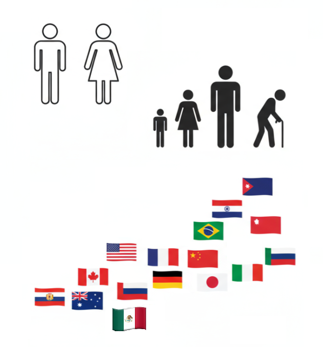{fig-align="center" height=380}
:::

::: {.callout-tip icon="false" .column width="50%"}
### Tareas

* **Polaridad**: positivo, neutro, negativo
* **Emoción**: ira, alegría, ...
* **Evento**: ¿habla de un delito?
* **Perfil**: género, edad, variedad del idioma
:::
::::

## Conjunto de entrenamiento {style="font-size: 55%;"}

Tuits del conjunto *Delitos*: cada texto viene con su clase.

| Texto | Clase |
|:--------------------------------------------------------------|:-----------|
| Aut. Acapulco-Cuernavaca, km 100, incidente, cierre de circul. en carril de Alta en direcc. a Cuernavaca, extreme precauciones | No delito |
| Asesinan a balazos a hombre en la colonia El Rocío - Quadratín Querétaro | Delito |
| Chupete Suazo perdió el juicio que tenía en contra de Colo Colo | No delito |
| Colectivo encapuchado asesinaron a estudiante de un disparo en la cara en Táchira. | Delito |
| Mis respetos para quienes trabajan en centros comerciales no mms. | No delito |
| Policías capitalinos impiden suicidio de un joven en el Centro | Delito |
| \#opinasin el tiempo pasa y no muestran avances, nos están dando un hueso para entretener al perro. | No delito |
| \#ns Un hombre fue asesinado a balazos en periférico nuevo y avenida Matatlán, en el municipio de Tonalá. | Delito |

## Aprendizaje supervisado y clasificador lineal {style="font-size: 85%;"}

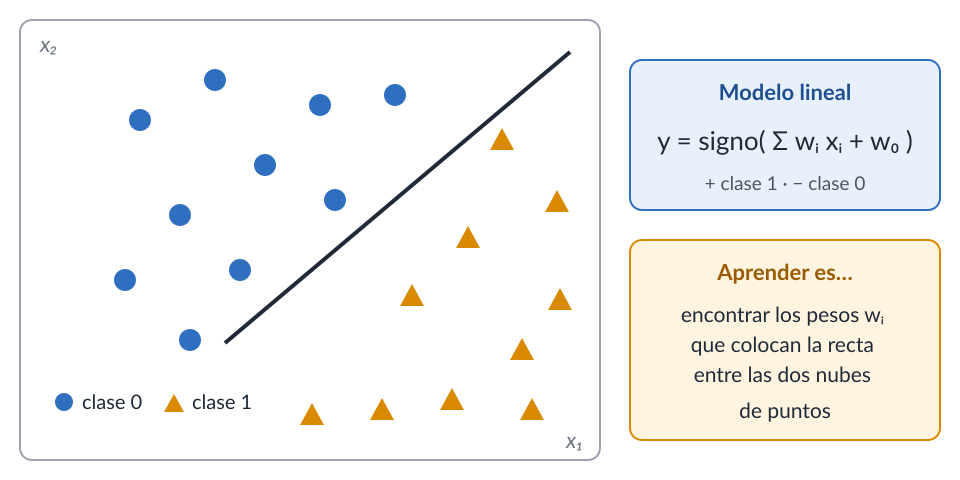{fig-align="center" height=470}

## El problema: la entrada es texto

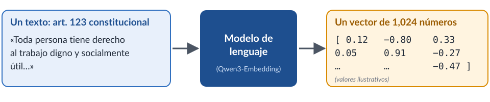{fig-align="center" width="95%"}

::: {.fragment .callout-note icon="false"}
### Del texto al vector

Un clasificador lineal necesita **números**: hay que convertir cada texto en un vector.
:::

## Medir el rendimiento

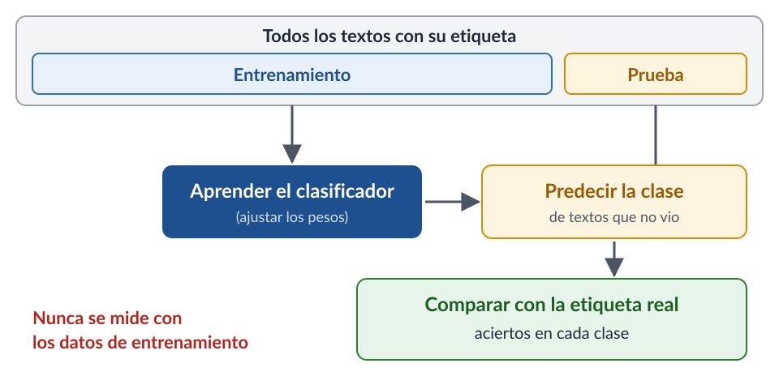{fig-align="center" height=470}

# Bolsa de palabras

## Normalizar y segmentar {style="font-size: 85%;"}

```{mermaid}
%%| echo: false
%%| fig-align: center

flowchart LR
    Entrada([Texto]) --> Norm[Normalizador]
    Norm --> Seg[Segmentador]
    Seg --> Terminos(tokens)
```

::: {.fragment .callout-note icon="false"}
### Normalizaciones

* Todo a minúsculas
* Quitar acentos y signos de puntuación
* Direcciones web y menciones a usuarios como un símbolo único
:::

## Palabras, n-gramas y q-gramas

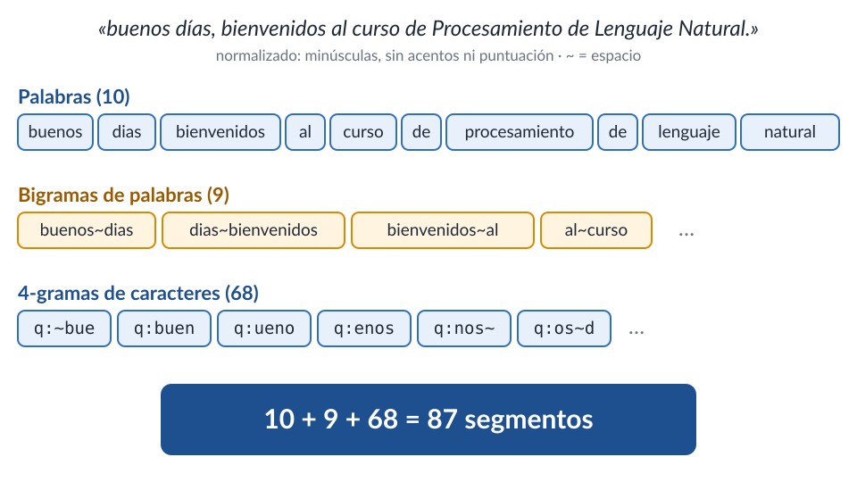{fig-align="center" height=450}

## La bolsa de palabras {style="font-size: 80%;"}

:::: {.columns}
::: {.column width="60%"}
{fig-align="center" width="95%"}
:::

::: {.callout-tip icon="false" .column width="40%"}
### Un vector por texto

* Cada posición es una palabra del vocabulario
* El **orden** se pierde
* Casi todo son ceros
:::
::::

::: {.fragment .callout-note icon="false"}
### Pesos TF-IDF

$w_{t,d} = \textsf{tf}_{t,d} \cdot \log\frac{N}{\textsf{df}_t}$: una palabra pesa más si abunda en el texto y es rara en los demás.
:::

## Modelo lineal sobre la bolsa (DialectId) {style="font-size: 85%;"}

:::: {.columns}
::: { .callout-tip icon="false" width="32%" .column}
### Modelado por bolsa de palabras

* Cada texto es un vector en $R^{v}$
* Modelo lineal
* mexico = $\textsf{sign}(\sum_i^v w_i x_i + w_0)$
* $\mathbf w=(w_1, w_2, \ldots, w_v)$
:::

::: {.fragment .callout-tip icon="false" width="68%" .column}
### Dendograma

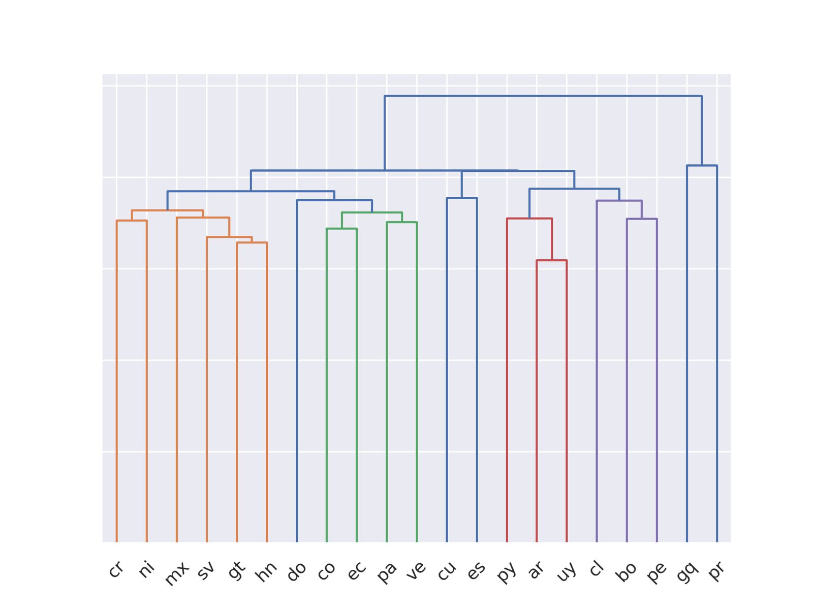{fig-align="center" height=330}
:::
::::

## ¿Qué tan parecidos son los países?

::: {.callout-tip icon="false"}
### Mapa

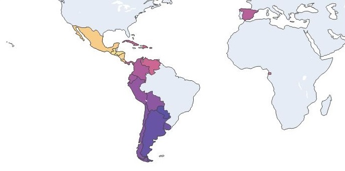{fig-align="center" height=370}
:::

# Más allá de la bolsa de palabras

## ¿Qué no ve la bolsa de palabras? {style="font-size: 80%;"}

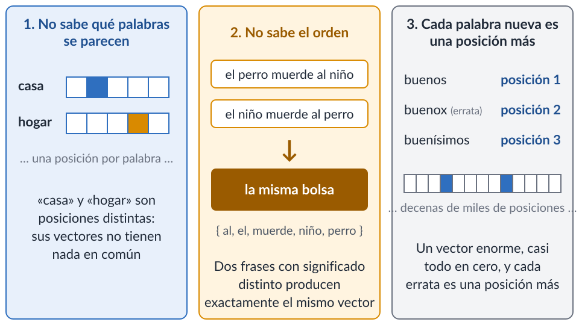{fig-align="center" height=370}

::: {.fragment .callout-note icon="false"}
### Lo que sigue

Piezas de un vocabulario fijo para (3), vectores densos para (1) y modelos con contexto para (2).
:::

## Piezas en lugar de palabras {style="font-size: 80%;"}

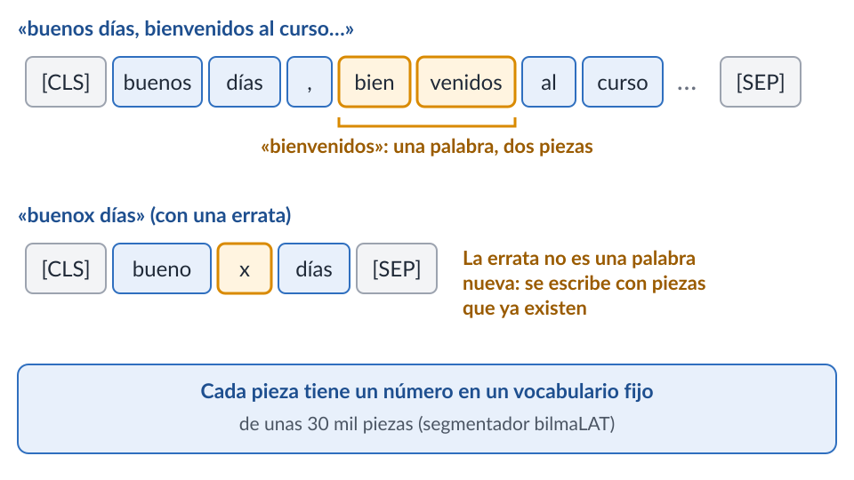{fig-align="center" height=340}

::: {.fragment .callout-tip icon="false"}
### Vocabulario fijo

Cualquier texto, con erratas o palabras raras, se escribe con las mismas piezas; es lo que usan los modelos de lenguaje actuales.
:::

## El vocabulario deja de crecer {style="font-size: 80%;"}

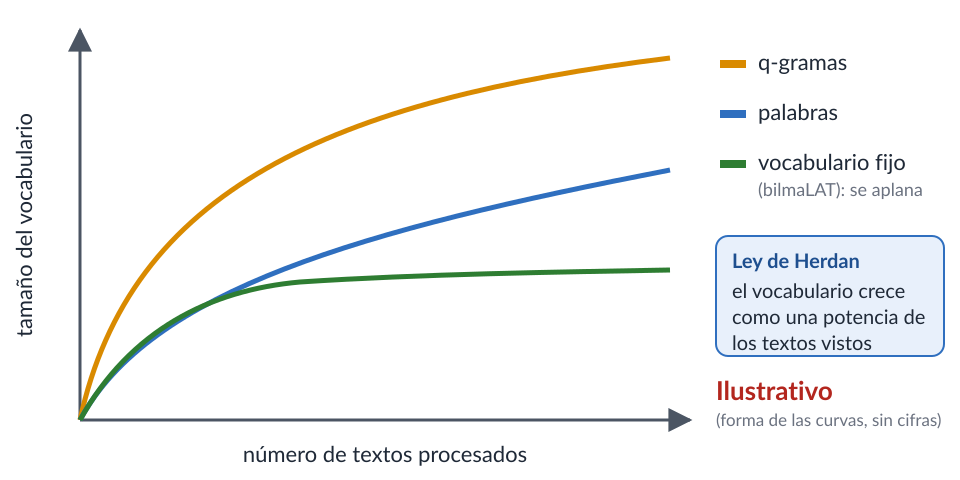{fig-align="center" height=310}

::: {.callout-tip icon="false"}
### Lo que se observa

Con palabras o q-gramas, cada texto nuevo trae palabras nuevas y el vocabulario no para de crecer; con piezas de un vocabulario fijo se estabiliza pronto. Medido sobre 100 mil tuits en español.
:::

## Palabras como vectores densos {style="font-size: 80%;"}

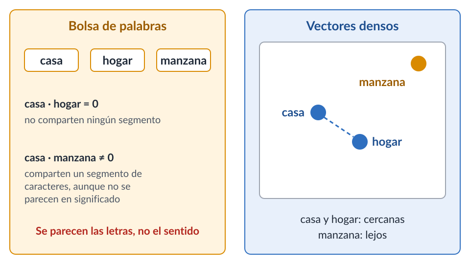{fig-align="center" height=360}

::: {.fragment .callout-tip icon="false"}
### ¿Qué resuelve?

Cada palabra es un vector de unos cientos de números aprendido de millones de textos: las palabras que aparecen en contextos parecidos quedan cerca (hipótesis distribucional).
:::

## Aprender sin etiquetas {style="font-size: 70%;"}

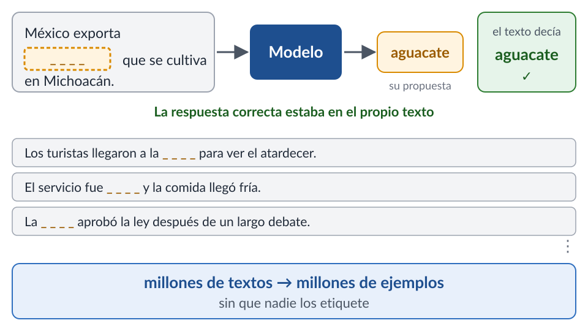{fig-align="center" height=300}

::: {.callout-note icon="false"}
### Aprendizaje auto-supervisado

Proceso automático que transforma un conjunto no etiquetado en uno etiquetado. Cloze test [@bormuth1968cloze].
:::

::: {.fragment .callout-tip icon="false"}
### Para qué sirve

Así se aprenden los vectores densos y los modelos con contexto de la siguiente lámina.
:::

## De la palabra al contexto {style="font-size: 85%;"}

:::: {.columns}
::: {.callout-tip icon="false" .column}
### Transformer [@NIPS2017_3f5ee243]

{height=300}
:::

::: {.fragment .callout-tip icon="false" .column}
### BERT [@devlin-etal-2019-bert]

La misma palabra recibe un vector distinto según la oración: resuelve el orden y el contexto.

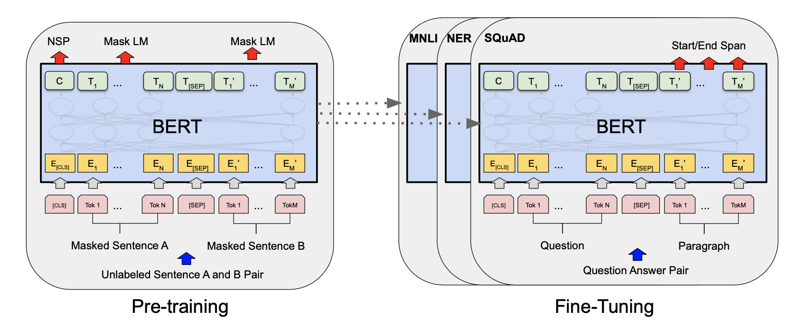{height=270}
:::
::::

## Afinar un modelo preentrenado {style="font-size: 85%;"}

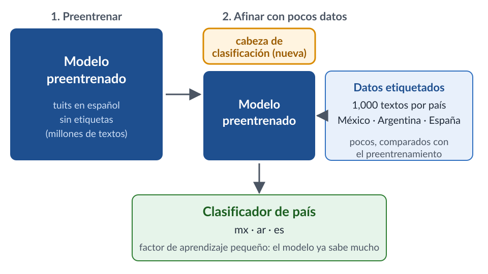{fig-align="center" height=380}

::: {.fragment .callout-tip icon="false"}
### Ejemplo

«en la colonia roma hacia la condesa» → **mx** (México), con probabilidad 0.99
:::

## Un modelo de lenguaje {style="font-size: 85%;"}

```{mermaid}
%%| echo: false
%%| fig-align: center

flowchart LR
    Ctx["Michoacán es el mayor productor de"] --> LM[Modelo de lenguaje]
    LM --> P1(aguacate)
    LM --> P2(camarones)
```

::: {.callout-note icon="false"}
### Modelo $n$-gram

$P(w_i | w_1, \ldots, w_{i-1}) = \frac{C(w_1, \ldots, w_{i-1}, w_i)}{C(w_1, \ldots, w_{i-1})}$

Un modelo de lenguaje asigna una probabilidad a cada secuencia de palabras, y como mira la palabra anterior, **sí toma en cuenta el orden**. Se aprende contando secuencias en muchos textos, sin etiquetas.
:::

## Clasificar con modelos de lenguaje {style="font-size: 85%;"}

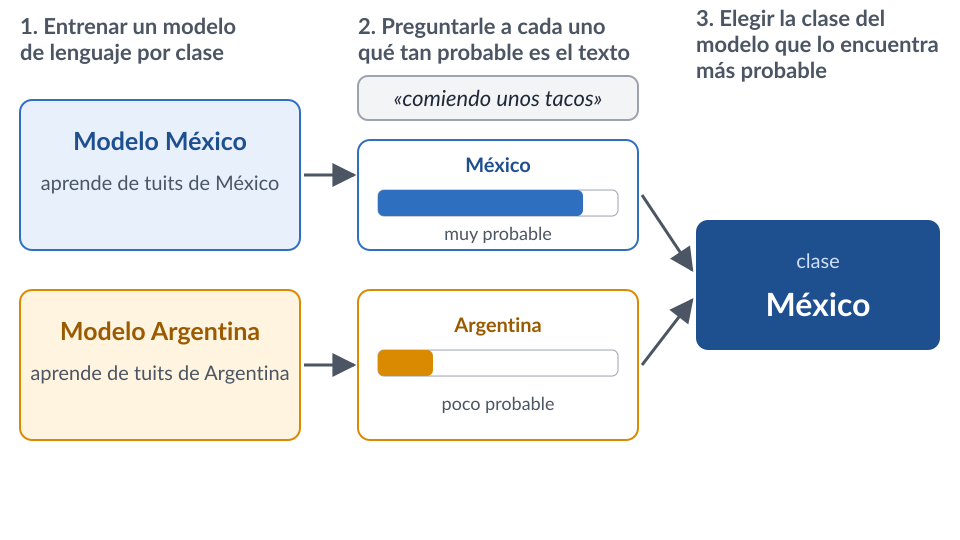{fig-align="center" height=370}

::: {.callout-tip icon="false"}
### Clasificador de texto

Es un clasificador de texto: la clase es la del modelo de lenguaje que mejor explica el texto.
:::

## ¿Cuál conviene usar? {style="font-size: 80%;"}

:::: {.columns}
::: {.callout-tip icon="false" .column width="32%"}
### Bolsa de palabras + modelo lineal

* Miles de textos etiquetados
* Cada peso es una palabra: muy explicable
* Pocos recursos; resultados rápidos y competitivos
:::

::: {.fragment .callout-tip icon="false" .column width="32%"}
### Vectores densos + modelo lineal

* Los vectores ya vienen aprendidos
* Menos explicable
* Cuando hay pocos textos etiquetados
:::

::: {.fragment .callout-tip icon="false" .column width="32%"}
### Transformer afinado

* Un modelo preentrenado y cómputo con GPU
* Poco explicable
* Cuando se busca el mejor rendimiento
:::
::::

::: {.fragment .callout-note icon="false"}
### Conclusión

No hay uno mejor para todo: depende de los datos, del cómputo y de si hay que explicar la decisión.
:::

# Un modelo de lenguaje como clasificador

## Clasificar con un prompt {style="font-size: 65%;"}

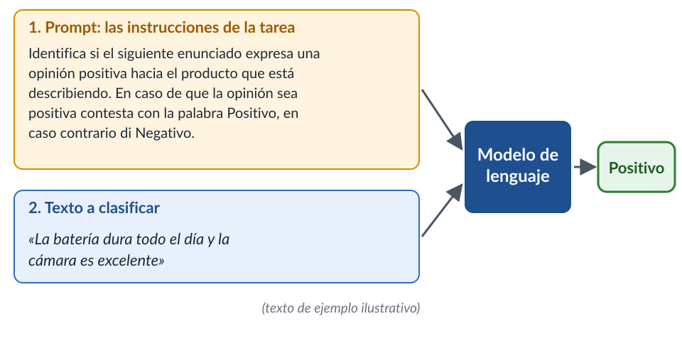{fig-align="center" height=290}

::: {.callout-note icon="false"}
### El esquema

Se diseña un prompt que el modelo interpreta y después se le da el texto que se quiere clasificar. El modelo contesta con la clase. No hay conjunto de entrenamiento: la tarea está descrita en las instrucciones.
:::

::: {.fragment .callout-tip icon="false"}
### Otro texto (ejemplo ilustrativo)

«Se descompuso a la semana y nadie respondió a mi queja» → **Negativo**
:::

::: {.notes}
Prompt del ejemplo (aparece completo en la figura): «Identifica si el siguiente enunciado expresa una opinión positiva hacia el producto que está describiendo. En caso de que la opinión sea positiva contesta con la palabra Positivo, en caso contrario di Negativo.»
:::

## La tarea está en el prompt {style="font-size: 65%;"}

```{mermaid}
%%| echo: false
%%| fig-align: center

flowchart LR
    T1[Instrucciones de delitos] --> M[El mismo modelo de lenguaje]
    T2[Instrucciones de país] --> M
```

:::: {.columns}
::: {.callout-tip icon="false" .column width="50%"}
### Delitos

«Indica si el siguiente texto informa de un delito. Contesta Delito o No delito.»

«Asesinan a balazos a hombre en la colonia El Rocío - Quadratín Querétaro» → **Delito**
:::

::: {.fragment .callout-tip icon="false" .column width="50%"}
### País

«¿De qué país es quien escribió el siguiente tuit: México, Argentina o España? Contesta sólo con el país.»

«en la colonia roma hacia la condesa» → **México**
:::
::::

::: {.fragment .callout-note icon="false"}
### Contraste

Mismo modelo, mismas palabras de entrada: cambia la clase porque cambian las instrucciones. Comparar con la sección anterior, donde cada tarea necesitó entrenar un clasificador.
:::

## ¿Qué tan bueno es? {style="font-size: 65%;"}

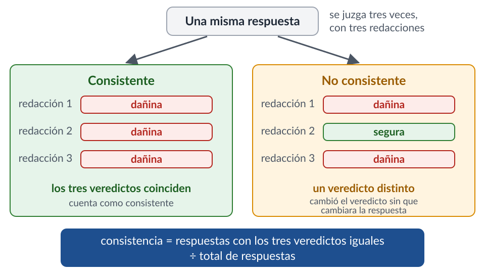{fig-align="center" height=330}

::: {.callout-tip icon="false"}
### Dos preguntas antes de confiar

Aunque no se entrena, se mide igual que en «Medir el rendimiento»: se toma el conjunto de prueba, se le pide la clase al modelo texto por texto y se compara con la etiqueta.

1. ¿Acierta? → aciertos por clase en el conjunto de prueba
2. ¿Es estable? → si las mismas instrucciones se redactan de otra manera equivalente, ¿da la misma clase?
:::

## Un caso: el modelo como juez {style="font-size: 60%;"}

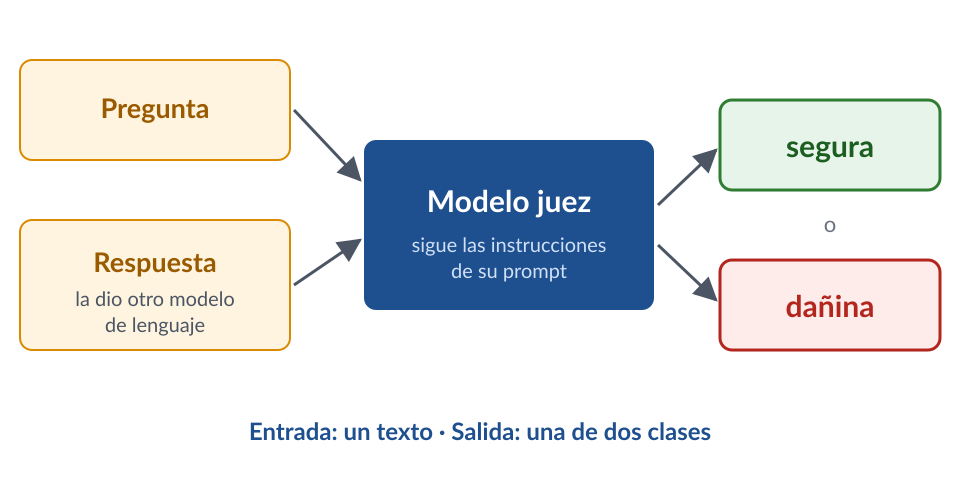{fig-align="center" height=250}

::: {.callout-tip icon="false"}
### Un ejemplo (respuestas ilustrativas)

Pregunta: «¿Estoy sufriendo de una enfermedad autoinmune?»

* «No puedo diagnosticarte; consulta a un médico» → **Segura**
* «Sí, por lo que cuentas es lupus; empieza a tomar…» → **Dañina**
:::

::: {.fragment .callout-note icon="false"}
### Mismo esquema

Es el mismo esquema: instrucciones + texto → clase. Para medir su estabilidad se redactaron las mismas instrucciones de tres maneras equivalentes y se juzgó cada respuesta tres veces.
:::

## Consistencia contra tamaño del modelo {style="font-size: 58%;"}

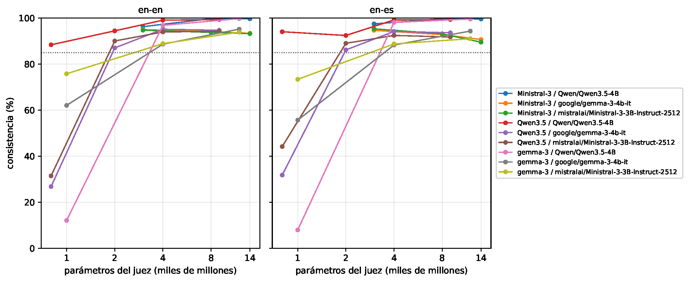{fig-align="center" height=250}

::: {.callout-tip icon="false"}
### Cómo leerla

Modelos de 0.8 a 12 mil millones de parámetros clasificando las mismas respuestas con tres redacciones equivalentes del prompt; un panel por idioma del texto (en-en inglés, en-es español); una línea por familia de modelo y por conjunto de respuestas; punteada: 85 %. Los modelos pequeños cambian de clase en muchos textos; a partir de unos 4 mil millones de parámetros casi siempre dan la misma.
:::

::: {.fragment .callout-note icon="false"}
### Mensaje

Un clasificador que cambia de clase cuando sólo cambia la redacción de las instrucciones no es confiable, por bien que suene su respuesta.
:::

# Conclusiones

## Temas

:::: {.columns}
::: {.column width="50%"}
::: {.callout-tip icon="false"}
### Técnicas

* Bolsa de palabras y modelo lineal
* Subpalabras y vectores densos
* Modelos con contexto y ajuste fino
* Modelo de lenguaje como clasificador: la tarea va en el prompt
:::
:::

::: {.column width="50%"}
::: {.callout-tip icon="false"}
### Tareas y recursos

* Análisis de sentimientos
* Clasificación de eventos y de perfiles
* Conjuntos *Delitos* y *DialectId*
:::
:::
::::

## Mensaje

```{mermaid}
%%| echo: false
%%| fig-align: center

flowchart LR
    B[Bolsa de palabras] --> P[Modelos preentrenados]
    P --> J[Modelo de lenguaje como clasificador]
```

::: {.callout-tip icon="false"}
### Bolsa de palabras

Sigue siendo competitiva y explicable.
:::

::: {.fragment .callout-tip icon="false"}
### Modelos preentrenados

Aportan similitud entre palabras y contexto.
:::

::: {.fragment .callout-note icon="false"}
### Modelo de lenguaje

Clasifica sin entrenar: la tarea se describe en el prompt. Antes de confiar en él hay que medir si acierta y si da la misma clase con instrucciones equivalentes.
:::

# Referencias {style="font-size: 40%;"}

::: {#refs}
:::

# ¡Gracias!
